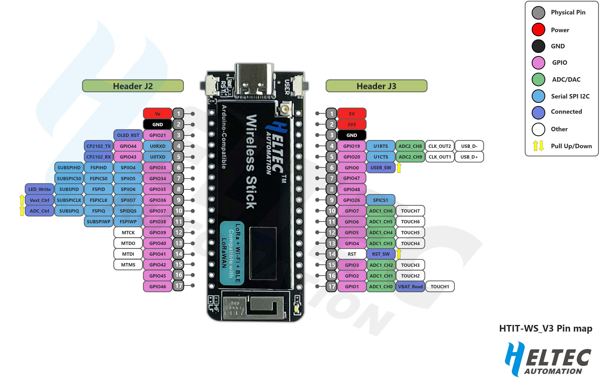

# Orchard Soil Monitoring

A staged IoT prototype for soil-monitoring decision support in remote, off-grid orchard environments. The repository is deliberately organised as a development story: it starts with a single RS485 soil probe, adds LoRa/MQTT transport, and finishes with a Raspberry Pi gateway that logs readings locally and submits them to Oracle APEX.

> **Scope:** soil monitoring. Irrigation/pump-control code developed elsewhere in the project is intentionally excluded from the curated branches.

## Why this repository exists

Remote orchards cannot assume continuous internet or stable power. This project explores a **hybrid edge–cloud** design where:

- a solar-powered sensor node reads soil moisture, temperature, conductivity, pH, N, P and K;
- readings travel over **LoRa** to a receiver;
- the receiver publishes to **MQTT**;
- a **Raspberry Pi Zero** gateway logs readings locally and forwards them to **Oracle APEX**;
- an APEX dashboard turns the readings into farm-facing decision support.

## Development path

| Branch | Stage | What it adds |
| --- | --- | --- |
| `phase-01-sensor-probe` | Phase 1 | Direct RS485/Modbus communication with the 7-in-1 soil sensor |
| `phase-02-lora-mqtt` | Phase 2 | LoRa sender/receiver, ACK + retries, duplicate handling, MQTT publishing |
| `phase-03-pi-apex` | Phase 3 | Deep-sleep soil nodes, Raspberry Pi gateway, APEX ingestion, diagrams |
| `main-final` | Final | Polished README, sanitised configuration, portfolio-ready snapshot |

## Phase 1 — Reading the soil probe

The first sketch talks directly to the 7-in-1 RS485 soil sensor. It sends the Modbus request frame, finds the expected `01 03 0E` response header, and decodes the seven registers.

**Files**

- `firmware/phase-01-soil-probe/Basic_sensor.ino`

**Key details**

- RS485 bus: `4800 baud`, `8N1`
- Pins: `RX = GPIO19`, `TX = GPIO20`, `RE/DE = GPIO21`
- Measured values: humidity, temperature, conductivity, pH, nitrogen, phosphorus, potassium

## Pinout references




## Repository layout

```text
firmware/                  Arduino sketches, grouped by development phase
docs/diagrams/             Pinout and architecture images
gateway/                   Raspberry Pi gateway code (added in Phase 3)
```

## Configuration and credentials

No Wi-Fi passwords, broker addresses, PI login details or other secrets are stored in this repository. Any local configuration must be supplied at deployment time and kept out of version control.

## Author

Gino-Dean Martin — University of the Western Cape, Department of Information Systems.
