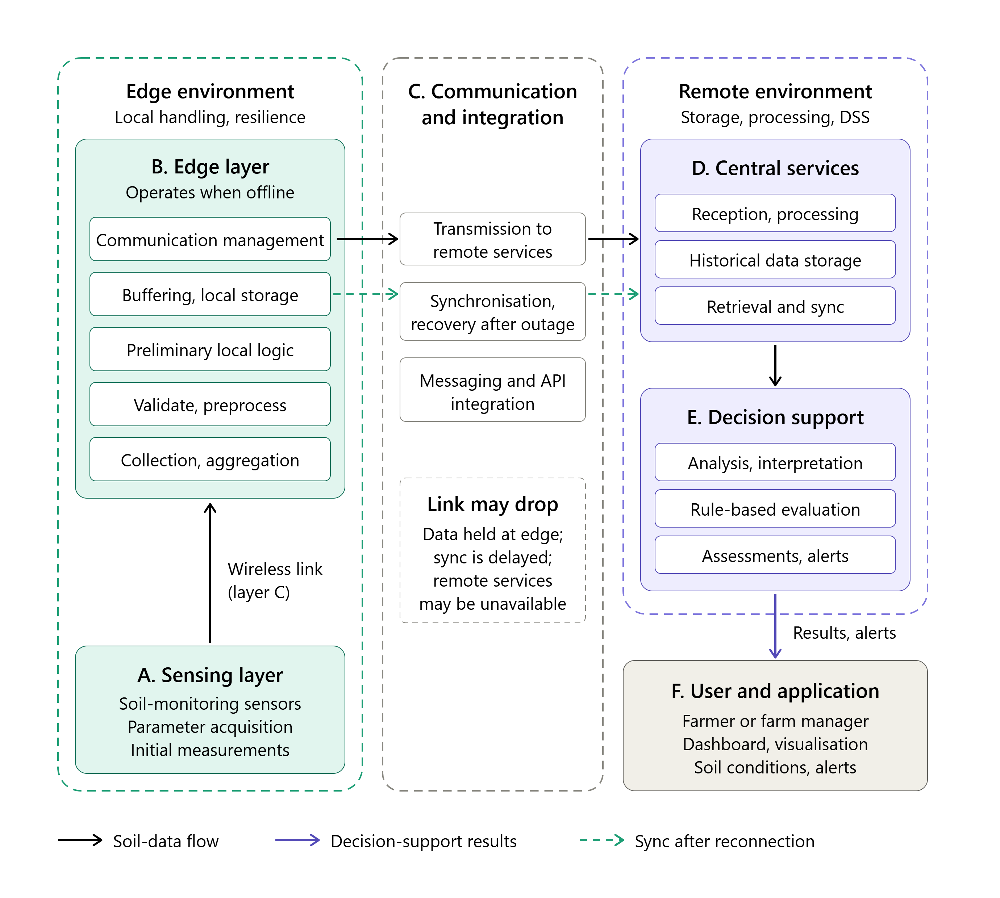
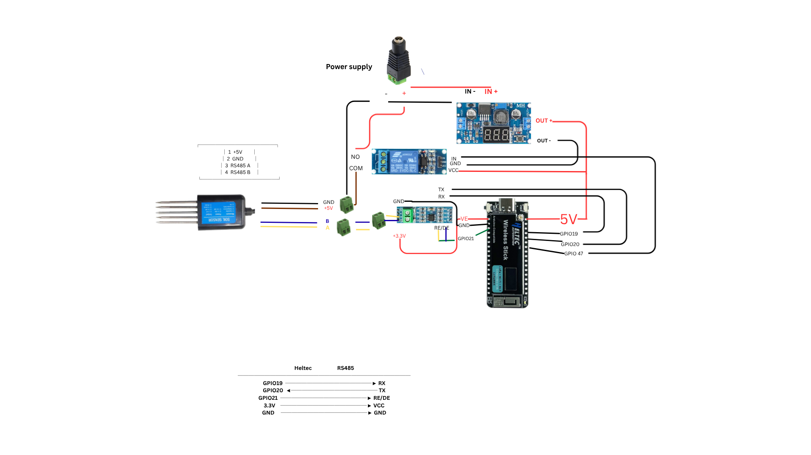
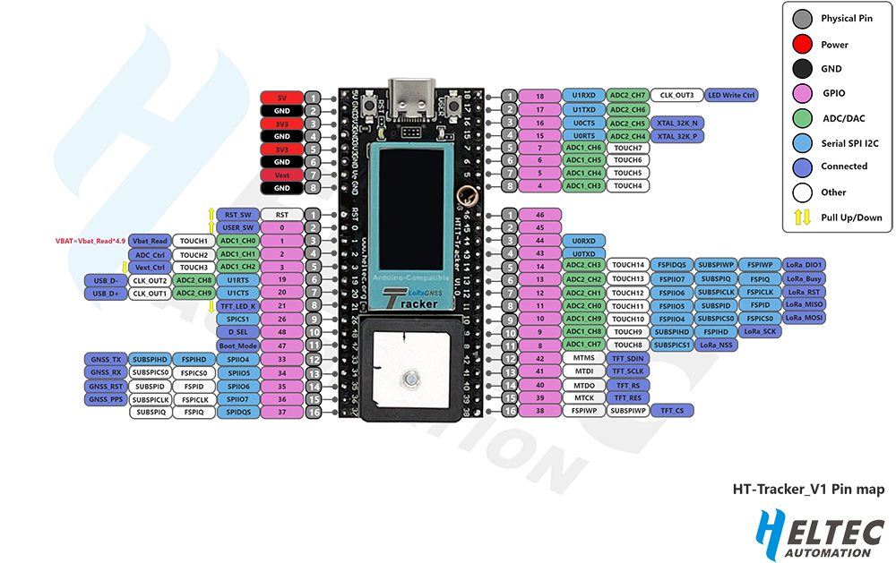

# Orchard Soil Monitoring

A staged IoT prototype for soil-monitoring decision support in remote, off-grid orchard environments. The repository is deliberately organised as a development story: it starts with a single RS485 soil probe, adds LoRa/MQTT transport, and finishes with a Raspberry Pi gateway that logs readings locally and submits them to Oracle APEX.

> **Scope:** soil monitoring. Irrigation/pump-control code developed elsewhere in the project is intentionally excluded from the curated branches.

## Why this repository exists

Remote orchards cannot assume continuous internet or stable power. This project explores a **hybrid edge–cloud** design where:

- a solar-powered sensor node reads soil moisture, temperature, conductivity, pH, N, P and K;
- readings travel over **LoRa** to a receiver;
- the receiver publishes to **MQTT**;
- a **Raspberry Pi Zero** gateway logs readings locally and forwards them to **Oracle APEX**;
- an APEX dashboard turns the readings into farm-facing decision support.

## Architecture



```text
Soil sensor (RS485/Modbus)
        │
        ▼
ESP32-S3 sensor node ──LoRa──► Heltec receiver ──MQTT──► Raspberry Pi Zero
                                      │                         │
                                      │ ACK / retry              │ local CSV log
                                      ▼                         ▼
                                 Sensor node              Oracle APEX DSS
```

## Development path

| Branch | Stage | What it adds |
| --- | --- | --- |
| `phase-01-sensor-probe` | Phase 1 | Direct RS485/Modbus communication with the 7-in-1 soil sensor |
| `phase-02-lora-mqtt` | Phase 2 | LoRa sender/receiver, ACK + retries, duplicate handling, MQTT publishing |
| `phase-03-pi-apex` | Phase 3 | Deep-sleep soil nodes, Raspberry Pi gateway, APEX ingestion, diagrams |
| `main-final` | Final | Polished README, sanitised configuration, portfolio-ready snapshot |

## Phase 1 — Reading the soil probe

The first sketch talks directly to the 7-in-1 RS485 soil sensor. It sends the Modbus request frame, finds the expected `01 03 0E` response header, and decodes the seven registers.

- RS485 bus: `4800 baud`, `8N1`
- Pins: `RX = GPIO19`, `TX = GPIO20`, `RE/DE = GPIO21`
- Values: humidity, temperature, conductivity, pH, nitrogen, phosphorus, potassium

## Phase 2 — LoRa transport and MQTT gateway

Phase 2 moves the probe reading onto a wireless link and adds the reliability behaviour that the final design depends on.

**Sensor node**

- Reads the same RS485 sensor through a relay-controlled power stage.
- Packs readings into a fixed 44-byte `SoilPacket`.
- Stores a sequence number in ESP32 non-volatile storage so reboots do not reuse sequence numbers.
- Waits for a 23-byte ACK after each transmission and retries up to two times.

**Receiver**

- Receives LoRa packets and sends an ACK for both new and duplicate packets. This lets a sender that missed the first ACK recover on retransmission.
- Tracks the last sequence number and suppresses duplicate MQTT publishes.
- Publishes new readings to `orchard/soil/<node-id>` as JSON containing the soil values plus RSSI and SNR.

**Files**

- `firmware/phase-02-lora-mqtt/soil-node/soil_node.ino`
- `firmware/phase-02-lora-mqtt/soil-node/soil_node_2.ino`
- `firmware/phase-02-lora-mqtt/receiver/receiver.ino`

## Pinout and hardware references






## Repository layout

```text
firmware/                  Arduino sketches, grouped by development phase
docs/diagrams/             Pinout and architecture images
gateway/                   Raspberry Pi gateway code (added in Phase 3)
```

## Configuration and credentials

No Wi-Fi passwords, broker addresses, PI login details or other secrets are stored in this repository. The Phase 2 receiver uses obvious placeholders; replace them locally before flashing. Any local configuration must be kept out of version control.

## Author

Gino-Dean Martin — University of the Western Cape, Department of Information Systems.
