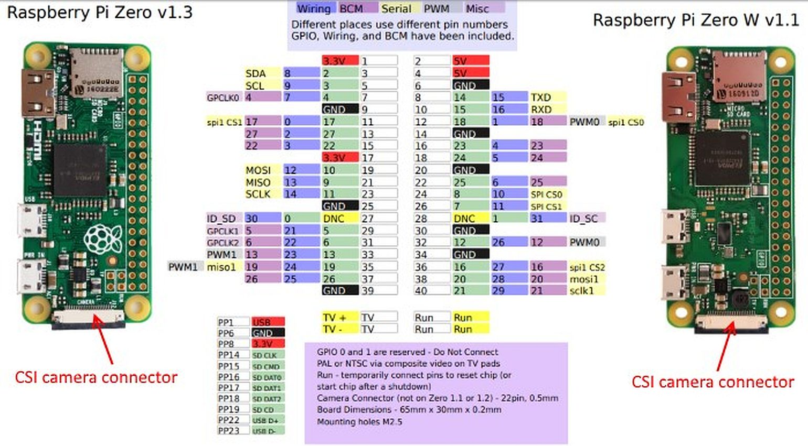

# Orchard Soil Monitoring

A staged IoT prototype for soil-monitoring decision support in remote, off-grid orchard environments. The repository is organised as a development story: it starts with a single RS485 soil probe, adds LoRa/MQTT transport, and finishes with a Raspberry Pi gateway that logs readings locally, retries failed submissions, and forwards them to Oracle APEX.

> **Scope:** soil monitoring. Irrigation/pump-control code developed elsewhere in the project is intentionally excluded from the curated branches.

## Why this repository exists

Remote orchards cannot assume continuous internet or stable power. This project explores a **hybrid edge–cloud** design where:

- a solar-powered sensor node reads soil moisture, temperature, conductivity, pH, N, P and K;
- readings travel over **LoRa** to a receiver;
- the receiver publishes to **MQTT**;
- a **Raspberry Pi Zero** gateway logs readings locally and forwards them to **Oracle APEX**;
- an APEX dashboard turns the readings into farm-facing decision support.

## Architecture


```text
Soil sensor (RS485/Modbus)
        │
        ▼
ESP32-S3 sensor node ──LoRa──► Heltec receiver ──MQTT──► Raspberry Pi Zero
                                      │                         │
                                      │ ACK / retry              │ CSV log + pending queue
                                      ▼                         ▼
                                 Sensor node              Oracle APEX DSS
```

## Development path

| Branch | Stage | What it adds |
| --- | --- | --- |
| `phase-01-sensor-probe` | Phase 1 | Direct RS485/Modbus communication with the 7-in-1 soil sensor |
| `phase-02-lora-mqtt` | Phase 2 | LoRa sender/receiver, ACK + retries, duplicate handling, MQTT publishing |
| `phase-03-pi-apex` | Phase 3 | Deep-sleep soil nodes, Raspberry Pi gateway, APEX ingestion, diagrams |
| `main` | Final | Polished README, sanitised configuration, portfolio-ready snapshot |

See [Development history](docs/development-history.md) for the branch graph and the reasoning behind each stage.

## Phase 1 — Reading the soil probe

The first sketch talks directly to the 7-in-1 RS485 soil sensor. It sends the Modbus request frame, finds the expected `01 03 0E` response header, and decodes the seven registers.

- RS485 bus: `4800 baud`, `8N1`
- Pins: `RX = GPIO19`, `TX = GPIO20`, `RE/DE = GPIO21`
- Values: humidity, temperature, conductivity, pH, nitrogen, phosphorus, potassium

## Phase 2 — LoRa transport and MQTT gateway

- Sensor nodes pack readings into a fixed 44-byte `SoilPacket` and store a sequence number in ESP32 non-volatile storage.
- Each transmission waits for a 23-byte ACK and retries up to two times.
- The receiver sends ACKs for both new and duplicate packets, so a sender that missed the first ACK can recover on retransmission.
- The receiver suppresses duplicate MQTT publishes and publishes new readings to `orchard/soil/<node-id>` with RSSI and SNR included.

## Phase 3 — Low-power nodes and the edge gateway

**Deep-sleep soil nodes**

- Two node sketches use a 15-minute measurement interval.
- The relay powers the sensor only during a reading.
- The node returns to deep sleep after each transmission attempt.
- Non-volatile sequence storage preserves packet identity across reboots.

**Raspberry Pi gateway**

- Subscribes to `orchard/soil/#` over local MQTT.
- Writes every accepted reading to `soil_data.csv`.
- Writes delivery telemetry to `soil_evaluation_log.csv`.
- Posts readings to Oracle APEX using header-based ORDS parameters.
- Stores failed posts in `pending_soil_data.csv` and retries them on a configurable interval.
- Reads all configuration from environment variables, so no deployment address or secret is committed.

**Files**

- `firmware/phase-03-deep-sleep-nodes/soil-node-1/soil_node.ino`
- `firmware/phase-03-deep-sleep-nodes/soil-node-2/soil_node.ino`
- `gateway/monitoring.py`
- `gateway/requirements.txt`
- `.env.example`
- `docs/apex-integration-notes.md`

## Running the gateway

```bash
cd gateway
python3 -m venv venv
source venv/bin/activate
pip install -r requirements.txt

cp ../.env.example ../.env
# Edit ../.env with your broker, storage path and APEX endpoint.

python monitoring.py
```

On Windows, activate with `venv\Scripts\activate` instead.

## Laboratory evaluation highlights

The associated research evaluated the artefact under controlled connectivity and power interruptions.

- Baseline: **46/46** expected packets were received and delivered to Oracle APEX (**100% PDR**).
- Internet outage with synchronisation: **6/6** buffered readings were delivered after connectivity returned.
- Combined synchronisation run: **53/53** received observations were eventually delivered.
- A separate one-hour outage delivered **4** buffered readings within **12 seconds** of reconnection.
- Readings were lost only when the LoRa receiver itself was powered off; those packets never reached the gateway.

These results support the value of local logging and retry, while also showing that gateway/receiver power and stronger sequence tracking remain important design concerns.

## Pinout and hardware references




## Repository layout

```text
firmware/                  Arduino sketches, grouped by development phase
gateway/                   Raspberry Pi logger and APEX ingestion client
docs/diagrams/             Pinout and architecture images
docs/                      Integration notes and development history
.env.example               Configuration template (copy to .env locally)
```

## Configuration and credentials

No Wi-Fi passwords, broker addresses, PI login details or other secrets are stored in this repository. Firmware placeholders and `.env.example` are intentionally generic. Keep real configuration in local files such as `.env`, which is ignored by Git.

## Author

Gino-Dean Martin — University of the Western Cape, Department of Information Systems.
